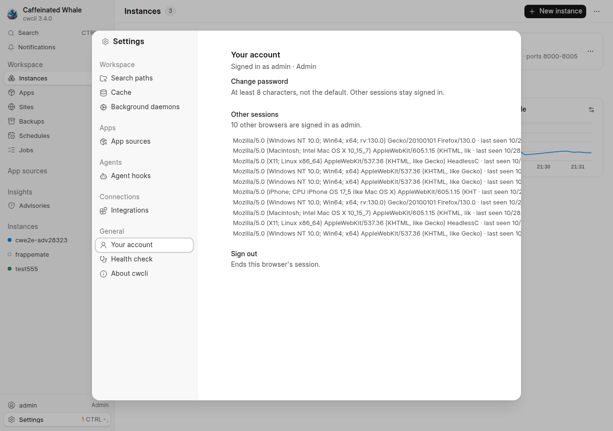
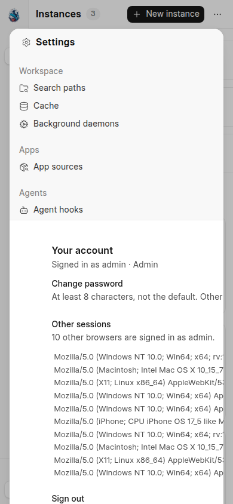
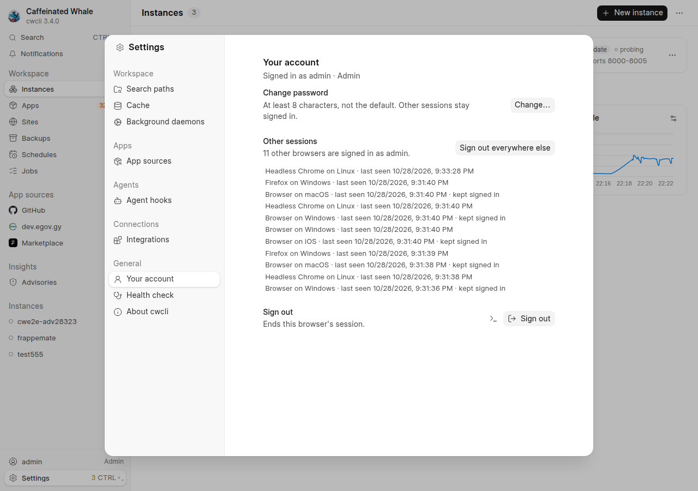
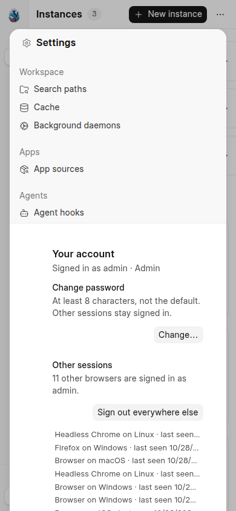

# Your account panel stays inside the settings dialog

Browser evidence for the Settings > General > Your account layout fix, taken with chrome-devtools-axi against a real web UI daemon built from this change.
The daemon ran under an isolated `CWCLI_HOME` on its own port, and ten extra sessions were signed in through `POST /api/v1/session` with real desktop and phone user-agent strings so the "Other sessions" list held long rows.

## The defect, reproduced on the unfixed build

Each "Other sessions" row rendered the stored user agent on one no-wrap line.
The panel is a flex-row item of the dialog, so its minimum width became the width of the longest row, and the whole column grew past the dialog's right edge: the Sign out button's right edge measured 1324 px in a 1280 px window whose dialog ended at 1088 px, and 928 px in a 390 px window.

| Width | Before |
| --- | --- |
| 1280 |  |
| 390 |  |

## The fix

The panel takes `min-w-0`, so the column keeps the width the dialog gives it and a long row truncates inside it.
Each row shows a short "browser on OS" label (`webui/src/data/user-agent.js`) with the raw user agent in the row's `title`, and below the `sm` breakpoint the account rows stack their control under the text instead of squeezing it.

| Width | After |
| --- | --- |
| 1280 |  |
| 390 |  |

Measured after the fix: the Sign out button's right edge is 1018 px at 1280 (dialog edge 1088) and 336 px at 390; the open password form's right edge is 332 px at 390.
