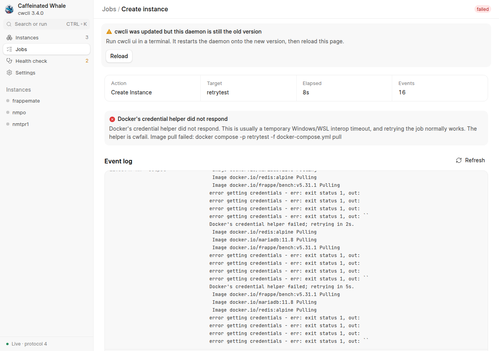
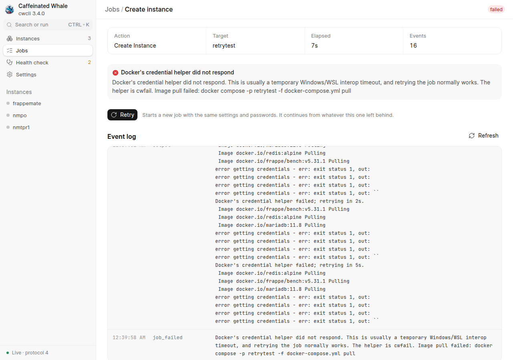
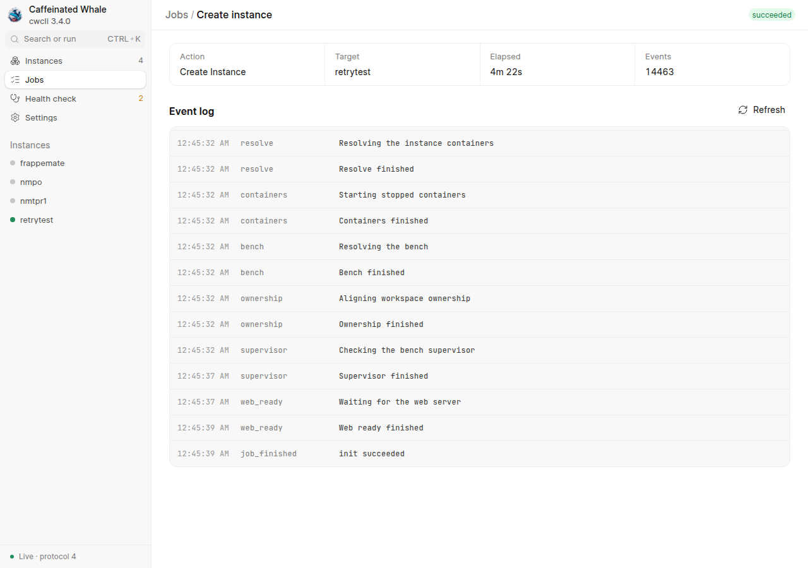
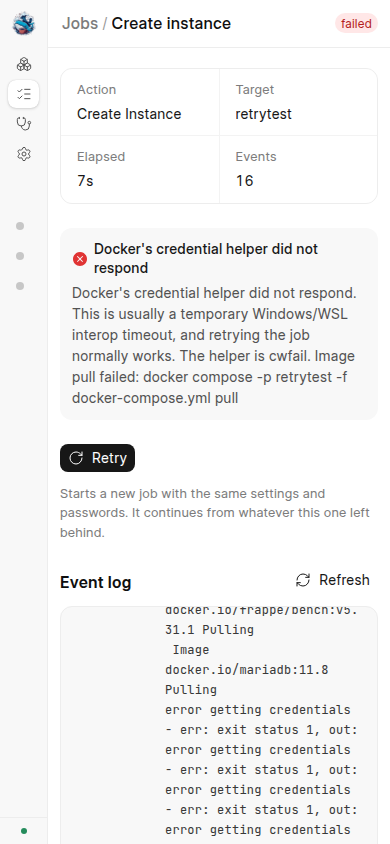
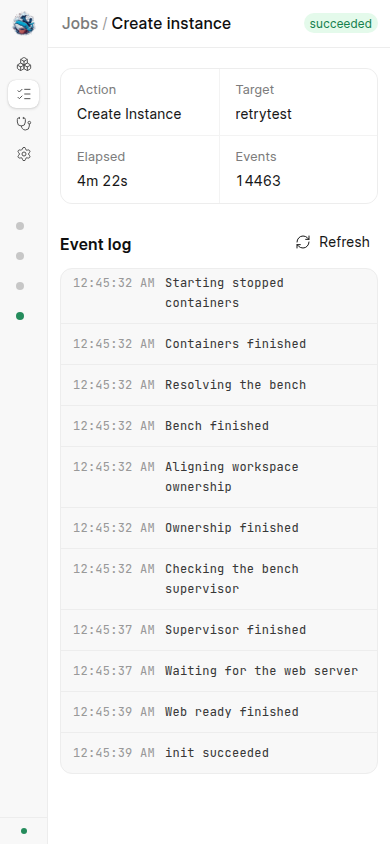

# Retry a failed job from its page

Browser evidence for the Retry action, taken with chrome-devtools-axi against a real `cwcli ui` daemon built from this change.
Everything ran under an isolated `HOME`, `XDG_CONFIG_HOME`, `DOCKER_CONFIG` and `CWCLI_HOME`.
The Docker config named a fake credential helper that fails the way a timed-out Windows helper does (the `error getting credentials ... out: ` message with an empty out) while a flag file existed, and answers "credentials not found" (anonymous pull) once the file is removed.

## The defect, reproduced on the unfixed build

A real instance creation (`retrytest`, first web port 28000, Frappe 16) was started from the New instance wizard.
It failed at the image pull step after cwcli's own two retries.
The job page named the cause and said "retrying the job normally works", yet offered no way to retry.
The failed run left `projects/retrytest/conf/docker-compose.yml`, `conf/db-root-password` and `data/` behind with no containers.

## The fix

A failed job now has a Retry button.
It posts to `POST /api/v1/jobs/<id>/retry`, which starts a NEW job with the same verb, target and args, and the page opens it.

| Width | Failed job with Retry | Retried job succeeded |
| --- | --- | --- |
| 1280 |  |  |
| 390 |  |  |

What the run showed:

- The retry of the failed creation (no ERPNext, same name, port, version and passwords) continued from the leftover `conf/` and `data/`: the compose file was reused, not refused, and the job went on to pull, start the containers and build the bench. It finished `succeeded` in 4m 22s.
- The passwords came from the daemon's memory, not from the form again: the database root password typed for the first attempt (`DbRoot-retry-3`) was accepted by the new instance's MariaDB, and no job file under `CWCLI_HOME/jobs` contains either password.
- After the daemon was restarted (it forgets the held passwords), Retry on an older failed job reopened the creation wizard on its Secrets step with every other field filled in, instead of failing.
- The throwaway instance was removed afterwards (`cwcli rm`), along with its volume and network.
