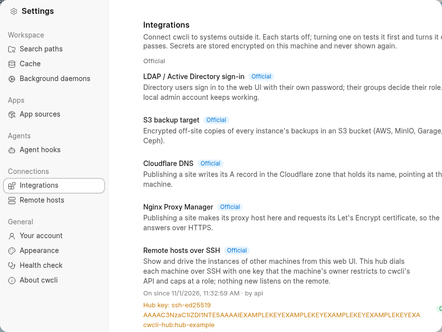
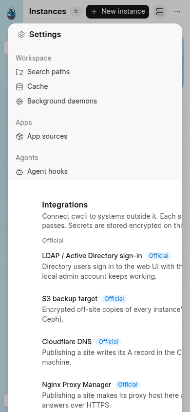
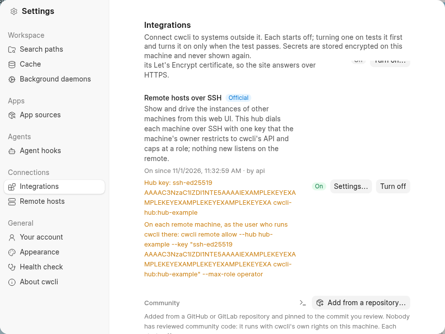
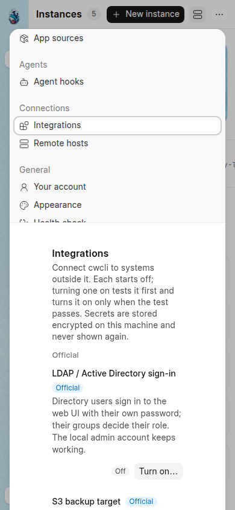

# Dialog content stays inside the dialog

Browser evidence for the shared dialog layout fix, taken with headless Chrome against a web UI daemon built from this change.
The daemon ran under an isolated `CWCLI_HOME` on its own port.
Every value in the captures is a placeholder: the hub is named `hub-example`, its public key file holds an `EXAMPLEKEY` blob written for the capture, the remote host, search path and app source are made-up names.

## The defect, reproduced on the unfixed build

Settings > Integrations, with Remote hosts over SSH turned on.
Its card shows the hub's public key and the `cwcli remote allow --hub ... --key "ssh-ed25519 ..." --max-role operator` command as lines with no break opportunity.
frappe-ui's tab panel is a flex-row item with no `min-width: 0`, so the longest line set the panel's width; the dialog clips its content box, so the right edge was cut: the Integrations intro lost its last words, the card's status button and the Community "Add from a repository…" button were cut off.

| Width | Before |
| --- | --- |
| 1280 |  |
| 390 |  |

Measured on the unfixed build: the dialog's content box ran from 192 to 1088 px in a 1280 px window and the panel's content reached 1301 px, with 44 elements past the edge.
At 390 px the dialog's box ran from 16 to 374 px and the tab root alone was 390 px wide (frappe-ui's `w-screen` below the `sm` breakpoint), so even the sidebar was cut; 107 elements lay past the edge.

## The fix

Three rules in `webui/src/style.css` apply to every dialog: a tab panel inside a dialog takes `min-width: 0`; dialog text may break anywhere when a word alone would overflow (`overflow-wrap: anywhere`, which leaves prose and truncated text as they were); a bare dialog's root is capped at the dialog's width.
Two local wrappers carry the phone layout for the Settings modal: `SettingsRow` stacks each row's control under its text below `sm`, and `SettingsHeader` lets a pane's actions wrap under its title when the row is too narrow for both.
The Integrations cards, which mirror a settings row, stack the same way, and the two "Add" forms (search paths, app sources) may shrink below their fixed input width.
The Settings pane's horizontal padding drops to 1rem below the `sm` breakpoint, because frappe-ui keeps 70 px on each side at every width and that left a 217 px column on a phone.

| Width | After |
| --- | --- |
| 1280 |  |
| 390 |  |

Measured after the fix, on the same seeded state: no element in any Settings pane lies past the dialog's edges at 1280 or 390 px, and the same holds for each dialog reachable without an instance (integration setup, turn off, community add, add host, remove host, update, new instance, appearance, new schedule, windows and guards, receive, backup retention, back up a site).

## The test

`tests/e2e/test_webui_modal_overflow_e2e.py` repeats this in CI at both widths: it seeds the long values through the API (the integration's hub key and allow command, a long search path, a long app source, a long remote host address, long browser user agents), opens every Settings pane and every dialog above, and fails when any element inside the topmost dialog lies past its horizontal edges or a control is clipped by an inner scroll region.
Each pane and dialog is measured as served and again with an unbreakable token appended to its text, so a long value anywhere in it is covered.
A second case on the shared session instance, `tests/e2e/test_webui_overflow_instance_dialogs_e2e.py`, covers the instance-backed dialogs: new bench, stop, new site, clone or move sites, clear cache.
Its file name sorts after `test_webui_navigation_e2e.py` on purpose, so it runs after the navigation proof, and both share the measurement in `tests/e2e/dialogs.py`.
