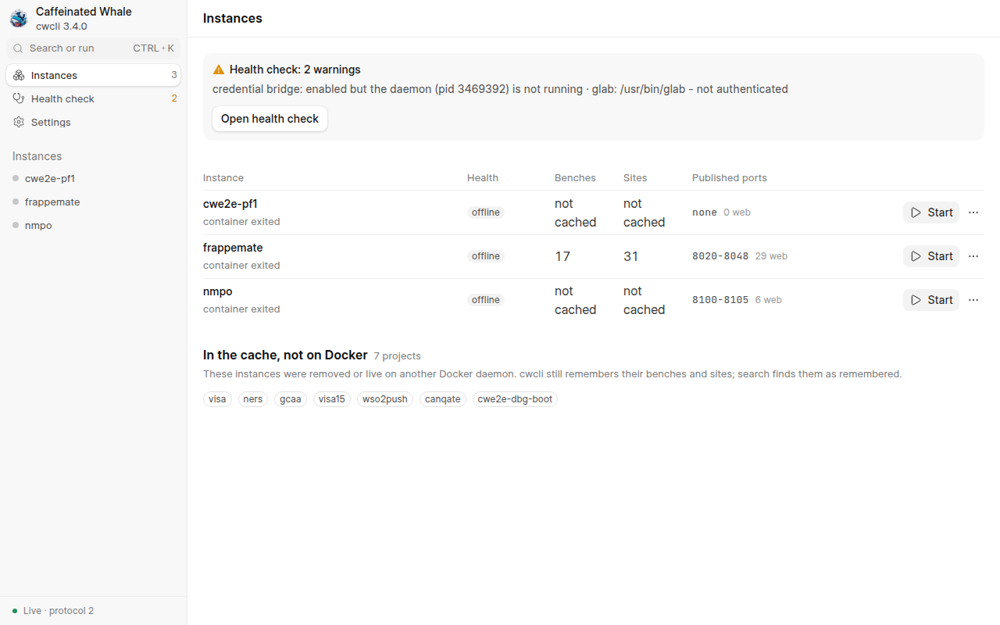
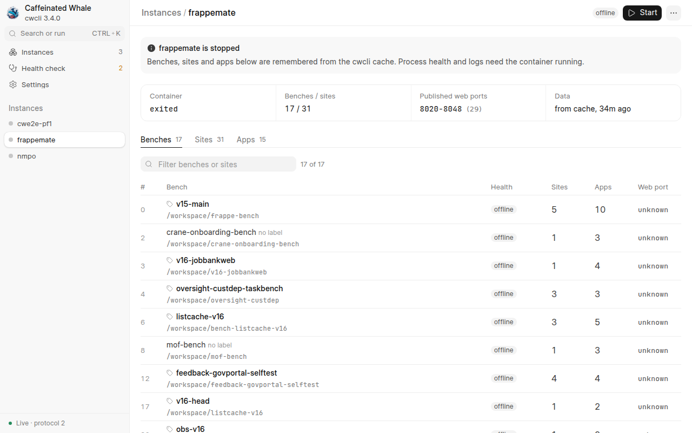
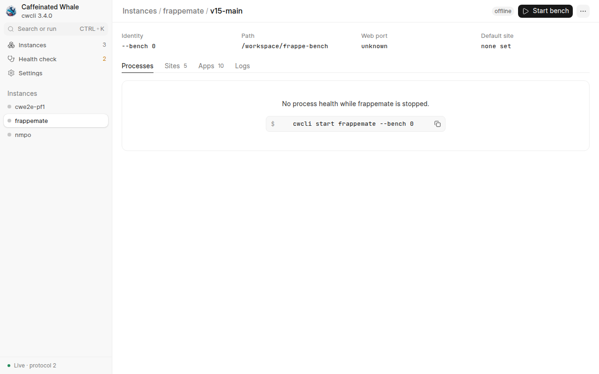
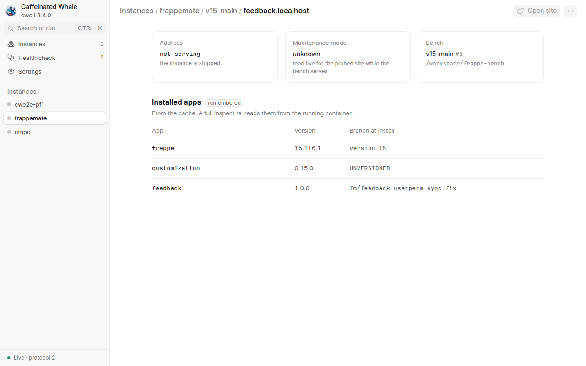
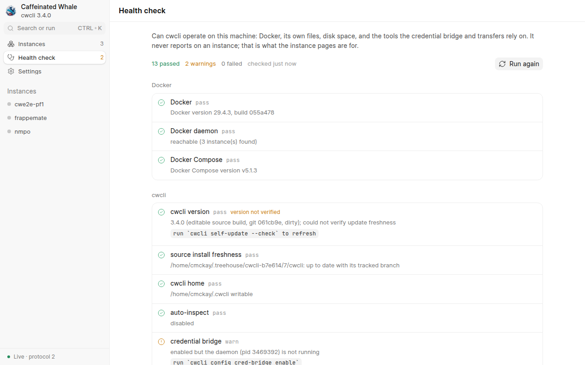
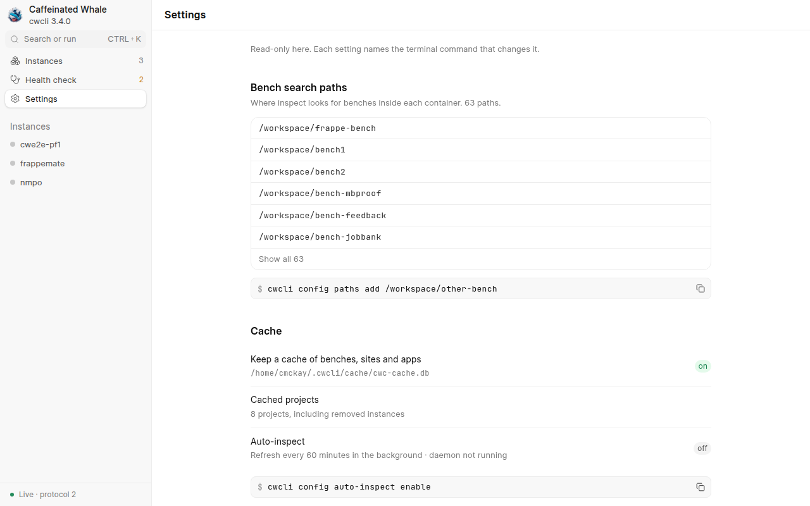
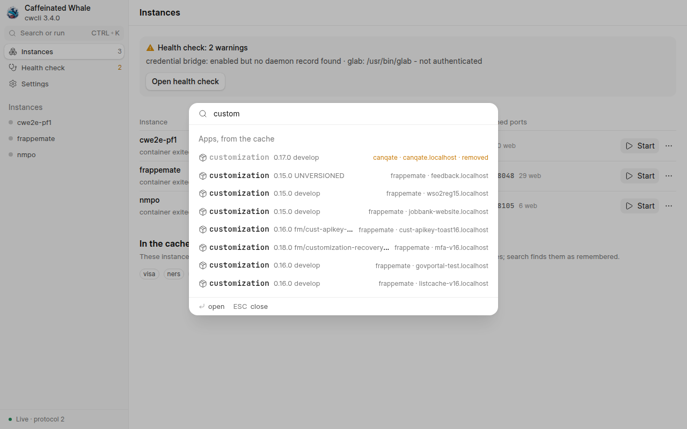
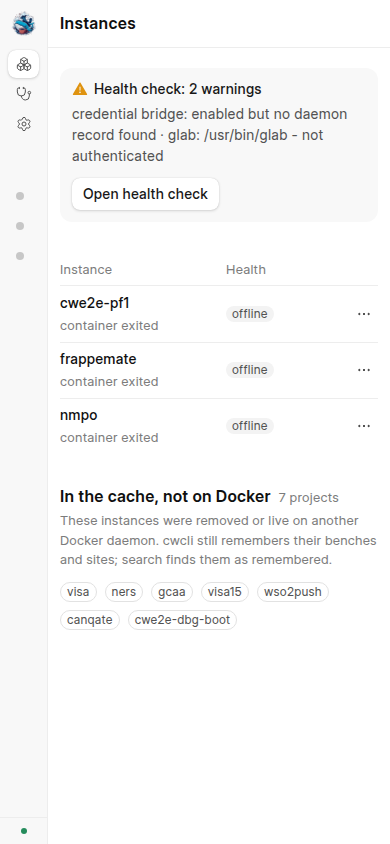
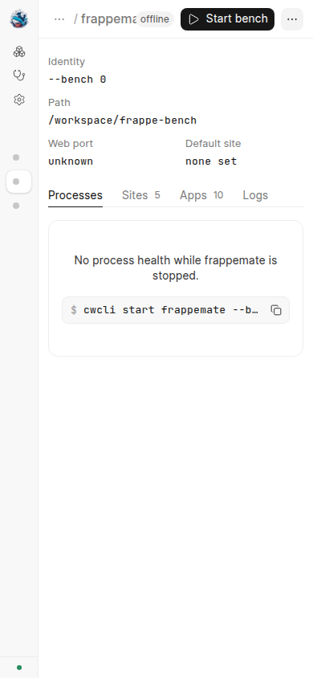

# Web UI, Phase 1: `cwcli ui` against this machine's real cache and Docker daemon

Evidence for the first shipped slice of the frappe-ui web app ("read everything plus daily lifecycle").
The daemon under test was the shipped `commands/serve.py` with every action refused (a local read-only wrapper), bound on `127.0.0.1:18765`, reading the operator's real `~/.cwcli` cache (three instances on Docker, all stopped; seven more remembered in the cache) so the pages show real data without touching any instance.
The browser was driven with `chrome-devtools-axi`; one screenshot at a time.

## What was verified

- `GET /` serves the built SPA with the strict policy, measured from the response header:
  `default-src 'none'; script-src 'self'; style-src 'self' <four reka-ui hashes>; img-src 'self' data:; font-src 'self'; connect-src 'self'; base-uri 'none'; form-action 'none'; frame-ancestors 'none'`, plus `X-Frame-Options: DENY` and `Cache-Control: no-cache`.
  The four hashes come from `dist/csp.json`, computed by the Vite build from the installed reka-ui; one of them is the ScrollArea hash the planning prototype measured by hand.
  The browser console showed no CSP violation on any page.
- The one-time sign-in link (minted through `POST /api/v1/session/code` with the bearer token, as `cwcli ui` does) signed the page in; the fragment was stripped from the URL bar.
- The SSE stream (`/api/v1/stream`) delivered the snapshot; the sidebar footer reads `Live · protocol 2`.
- Every page: Instances (live rows plus the remembered projects), Instance (summary strip, Benches/Sites/Apps tabs, 17 benches filterable), Bench (identity, path, Processes/Sites/Apps/Logs tabs), Site (address, maintenance, installed apps with the verified/remembered badge), Health check (13 passed, 2 warnings, honest `version not verified` qualifier), Settings (read-only, each row naming its command), and the Ctrl+K palette searching the cache (`customization` across nine sites, a removed project's row in amber).
- The only console errors were the expected `409` from the detail read of two never-inspected stopped instances, which the Instance page renders as "cwcli has not inspected ..., and it is stopped" with the command to run.
- Built size: 1.9 MB on disk (586 KB JS, 460 KB CSS, two Inter faces, JetBrains Mono subsets, a 28 KB logo).

## Screenshots

1280 px wide:

390 px wide (the sidebar collapses to its icon rail; tables drop their secondary columns):

## Real-instance proof

The actions (start/stop/restart instance and bench, stop bench, restart process, label, unlock, take a site out of maintenance, scale consent, checkout) are proven against a genuine instance by `tests/e2e/test_serve_e2e.py`, which drives the shipped `cwcli ui --foreground` binary on the CI E2E matrix.
