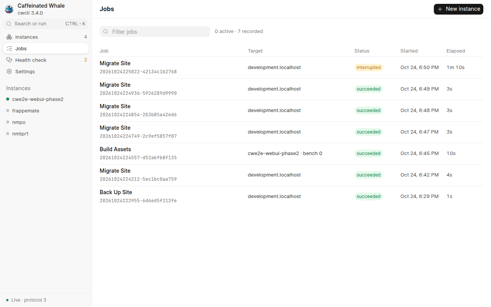
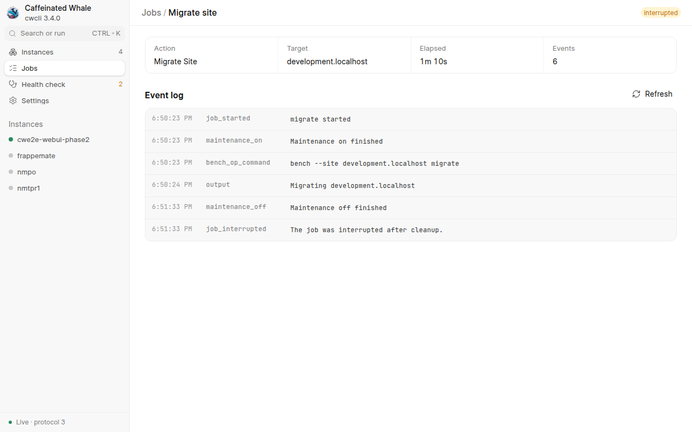
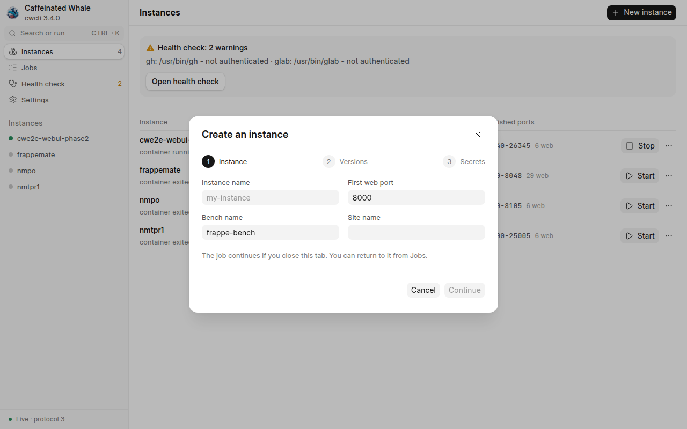
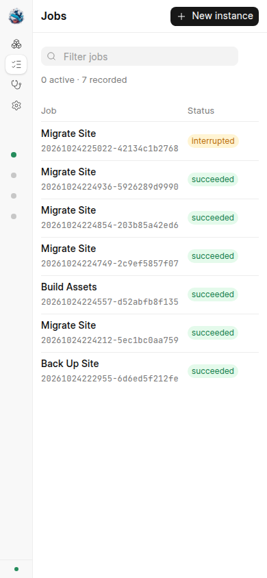
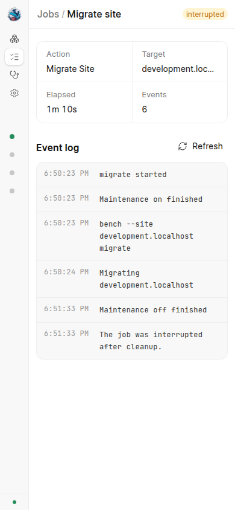

# Web UI, Phase 2: detached jobs against a real instance

Evidence for the second slice of the frappe-ui web app ("jobs and the long verbs").
The daemon under test was the shipped `cwcli ui` (detached, `127.0.0.1:18877`) against an isolated `CWCLI_HOME` holding one throwaway v16 instance, `cwe2e-webui-phase2`, created with the editable install from this branch.
The browser was driven with `chrome-devtools-axi`; one screenshot at a time; the instance was removed with `cwcli rm` afterwards.

## What was verified

- A `backup` job created through `POST /api/v1/jobs` ran as a detached worker (its pid is not the daemon's), recorded `backup_step_start`/`backup_step_end` events, and read back the same durable record after the worker exited; the real-Docker version of this proof is `tests/e2e/test_serve_e2e.py::TestDetachedJobs`, which also stops and starts the bench as jobs.
- `migrate` and `build` jobs started from the Site and Bench "More actions" menus landed on the job page, which followed the event log live through the one SSE stream (`job` frames bump `event_count`, the page fetches `?after=<seq>`).
  The command's own output renders as one terminal block per run, so a migrate's progress bar is one collapsed line rather than a row per repaint.
- Interrupt, proven deterministically: the in-container `bench migrate` was frozen with `SIGSTOP` (the technique `tests/e2e/test_migrate_sigterm_maintenance_e2e.py` uses) while the job sat at `running`; clicking Interrupt moved it to `interrupting`, the worker's cleanup ended the frozen process (SIGTERM grace, then SIGKILL) and cleared maintenance last, and the job ended `interrupted` with `maintenance_off` and `job_interrupted` as its final events.
  The site's `maintenance_mode` read 0 and no migrate process remained in the container.
- The Jobs page lists every record newest first with its state badge, target, start time and a ticking elapsed; the sidebar carries the active count.
- The New instance wizard (Instance, Versions, Secrets steps) opens from Instances and from Jobs; passwords go to the dedicated `secrets` field, never the spec.
- `apps update` jobs run `core.update` with `preflight=True`, and the job page renders the `update_preflight` event as a findings section (unit-pinned in `tests/test_jobs.py`).
- After a `self-update` the daemon restarts with the same session id, so the signed-in page's cookie survives; the page re-reads `/api/v1/meta` when its stream reconnects and reloads on a new version or protocol.

## Screenshots

1280 px wide:

390 px wide:

