# Web UI, Phase 3: guarded destructive verbs and settings, against a real instance

Evidence for the third and last planned slice of the frappe-ui web app ("guarded destructive verbs and settings").
The daemon under test was the shipped `cwcli ui` (`--foreground`, `127.0.0.1:18878`) from this branch's editable install, against an isolated `CWCLI_HOME` under `/var/tmp` holding one throwaway v16 instance, `cwcli-p3-proof`, created with `cwcli init` from the same install.
The browser was driven with `chrome-devtools-axi` in a dedicated session, one screenshot at a time.
Every outcome below was read back from the container, the host filesystem or the daemon's job record, never from the page's own words.

## What was verified

- **A typed `rm-site` backs up, then drops.** A throwaway site (`p3dropa.localhost`) was created with `bench new-site` and seeded with one ToDo through Frappe.
  From the Site page, More actions > Drop site opened the dialog; its red Drop site button stayed disabled until the exact site name was typed back.
  Confirming created job `rm-site` (`consent: true` in the spec, never before the typed name), which ran detached and ended `succeeded` with `ok: true`.
  On the host, `archive/cwcli-p3-proof_dropped_sites/p3dropa.localhost_<ts>/backups/` held the database dump (the seeded marker was found inside the gzip), both file archives and the site config, beside `p3dropa.localhost.tar`; in the container the site directory and its database were gone and `archived/sites/` held nothing (`archive_pruned_in_container: true`).
  The event log carried `drop_site_notice`, `drop_site_command` and the `bench drop-site` output.
- **A failing backup drops nothing.** A second seeded site (`p3dropb.localhost`) had its `private/backups` made unwritable.
  The same dialog and confirmation produced a job that ended `failed` with `rm_site.backup_failed` ("Could not backup site ...; nothing was dropped") and bench's own "Backup failed for Site" line in the error detail.
  The site directory, its database and the seeded record were all still there, no `archived/sites/` entry existed, and no half-written host archive directory was left.
- **Remove instance** (`rm`) from the Instance page's Danger zone: the dialog explains the backup gate, offers "Keep the named volumes" (`--no-volumes`), and arms only on the typed instance name.
  Confirming on the running instance ran the `rm` job to completion: every site backed up to `archive/cwcli-p3-proof_<ts>/`, then the containers, named volumes, project network and project directory removed, and the instance gone from `docker ps -a` and from the sidebar.
  The job spec carries `consent: true` only; nothing in it can express `--no-backup`, and a stopped instance on the volume-deleting path is refused `rm.not_running` before the core is called (unit-pinned).
- **Remove bench** (`rm-bench`) is disabled in the bench's menu with "(stop the bench first)" while it serves; after a `stop-bench` job the dialog opens and arms on the typed bench name.
- **Check out ref, discarding local changes** (`apps checkout --reset`) sits in each app row's menu under Danger zone and arms on the typed app name plus a ref; the plain checkout keeps its own entry.
- **Settings writes**, each read back from `config/config.toml` under the isolated home: adding a search path, the prune check (which honestly refused to prune while the other instances on this Docker daemon were stopped, naming them), removing the path, tips off and on, auto-inspect on (its daemon ran one cycle over the running instance only) and off, with the switch, interval and boot-hook controls beside the terminal command for each.
- **Fork safety, found by this proof.** Enabling auto-inspect from the daemon forked the background daemon from a request thread, and `ss -ltnp` showed the child holding the UI daemon's listening socket.
  `utils.daemon_identity.fork_is_safe` now sends a multithreaded host down the detached-spawn path for both auto-inspect and the credential bridge; after the fix only the daemon's pid holds the port and the child is a spawned interpreter.
- The real-Docker regression tests for the job half live in `tests/e2e/test_serve_e2e.py::TestGuardedDestructiveJobs` (both halves of the gate through the daemon) and `::TestSettingsWrites`.

## Screenshots

1280 px wide:

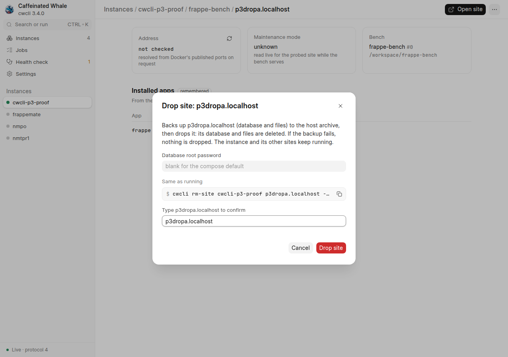
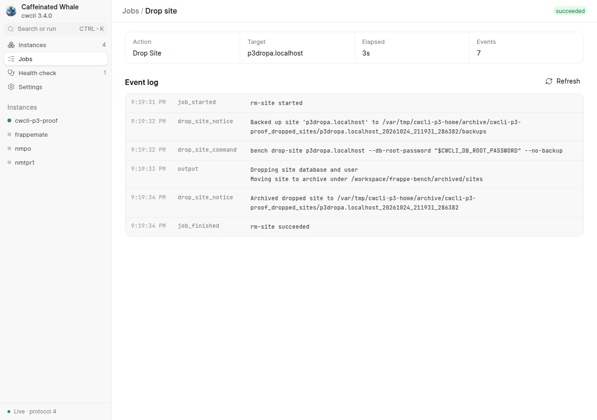
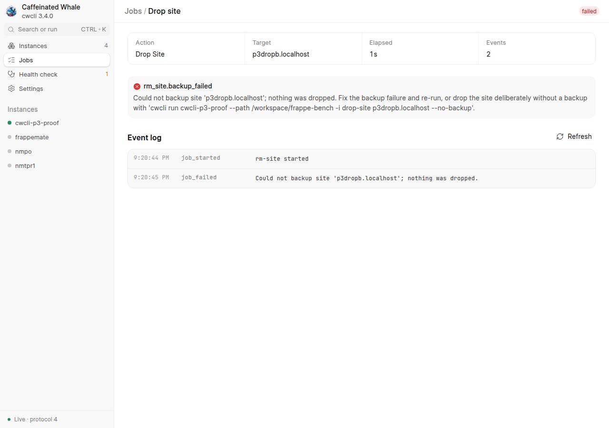
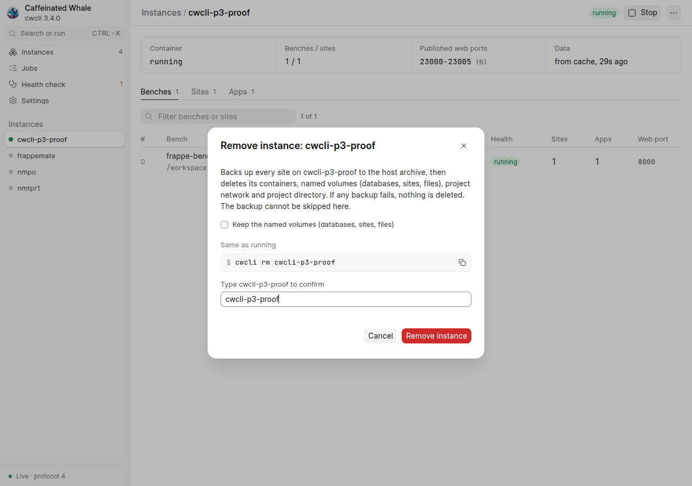
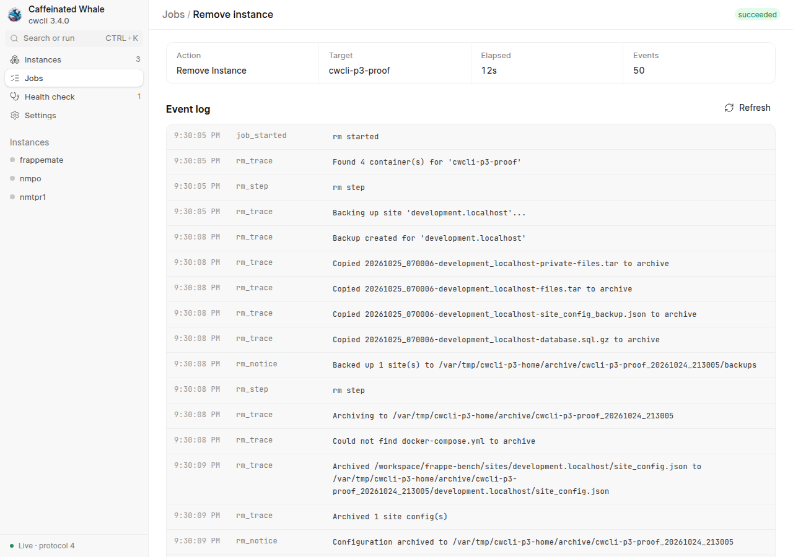
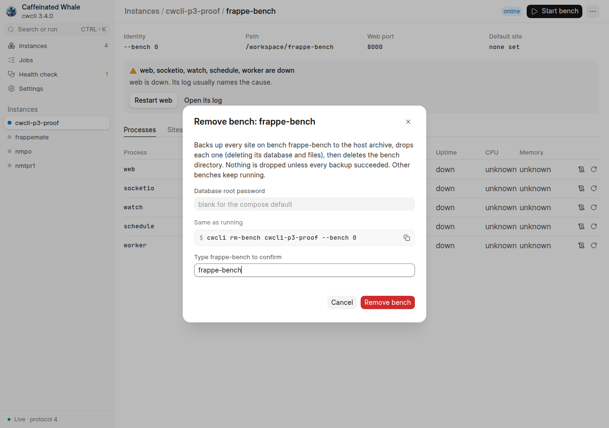
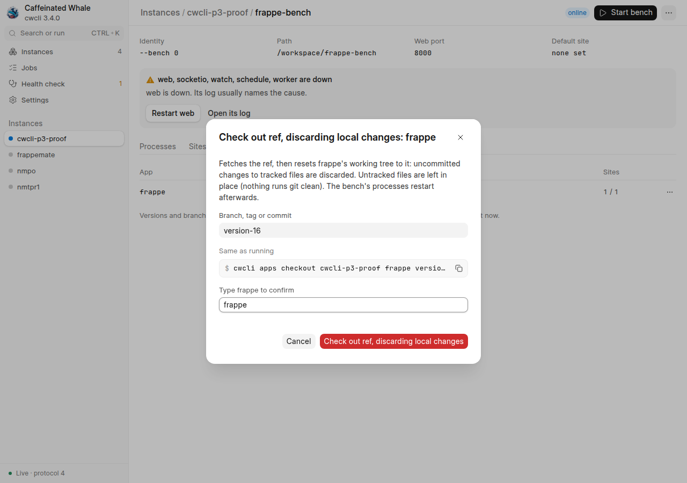
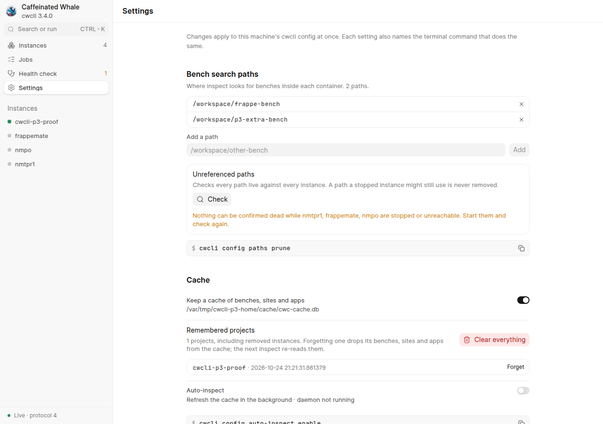

390 px wide:

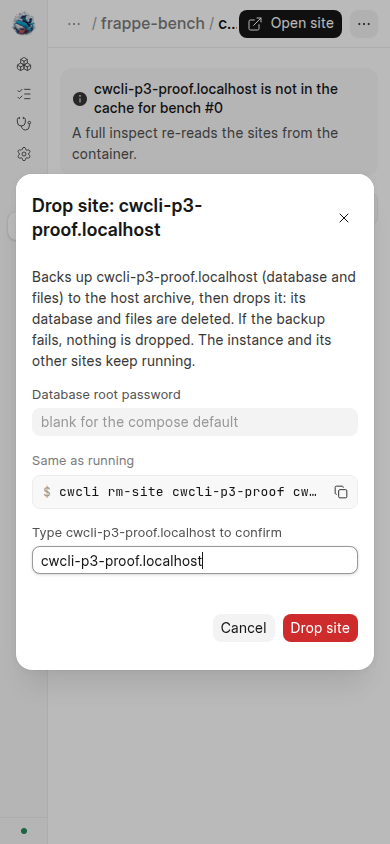
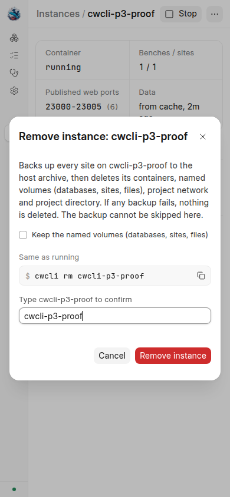
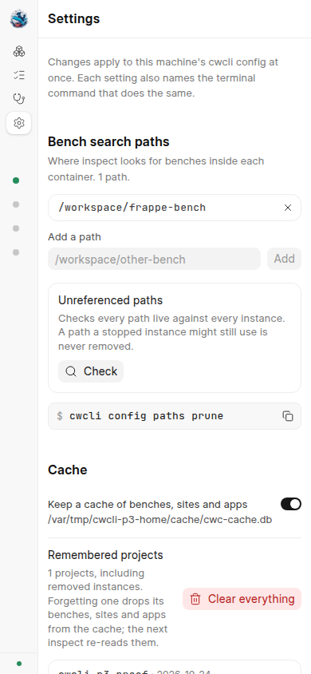
