# The web UI's premium look: moving gradient sign-in, fleet hero, gradient sidebar, Appearance controls

Browser evidence for the premium layer under `webui/src/premium/`, taken with chrome-devtools-axi against a real web UI daemon built from this change.
The daemon ran under an isolated `CWCLI_HOME` on its own port and served the package data built by `npm run build`.
The captures below are of pages that carry no instance, site or host names.

## The sign-in page

A split page.
The form sits centred on a calm panel: a short heading, one line of copy, the two fields, "Keep me signed in" and a pill-shaped Sign in button.
The right half is the moving Arc-style gradient carrying a large mixed-case wordmark, with a version badge, a headline and a tagline bottom-left over a surface-coloured scrim.
On a phone the gradient becomes a band on top and the form sits below it.

| Width | Light | Dark |
| --- | --- | --- |
| 1280 | 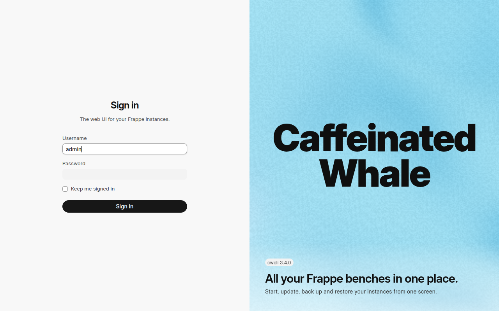 | 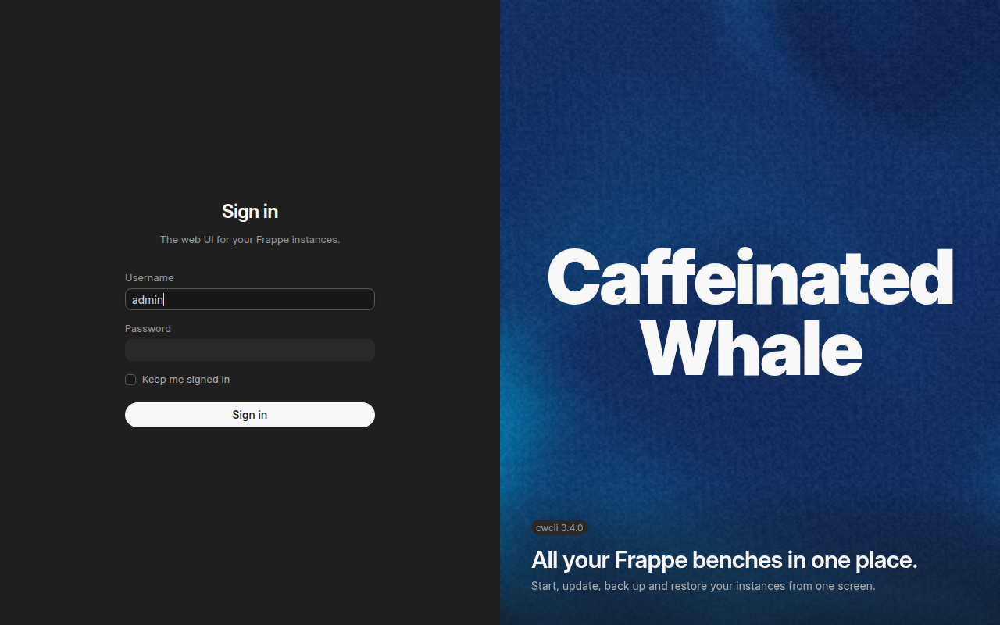 |
| 390 | 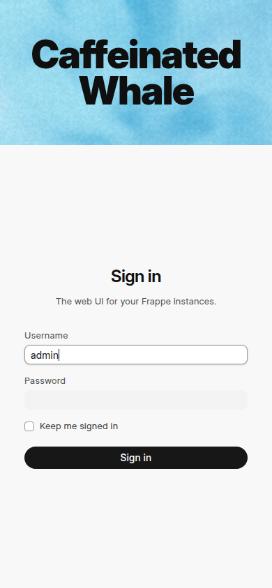 | 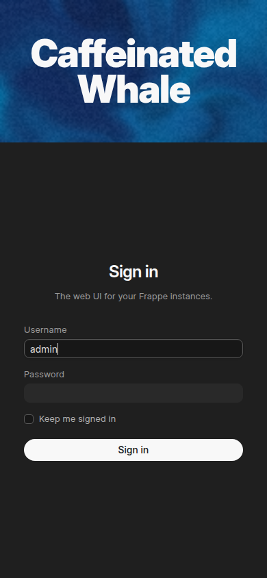 |

The wordmark is Inter Display (the self-hosted Inter 4 variable font at optical size 32, weight 900), sized from the viewport so its longer line fills 88 percent of the panel inside its padding: 96 px at 1280, 55 px at 390.
It is set in `text-ink-gray-9`, which is above AA on every theme stop in both schemes (the light stops are pastel, the dark stops deep, by design of the theme table).

## Settings > General > Appearance

The same controls the sidebar's Appearance row opens: the eight gradient themes (light and dark stops each), the light / dark / system choice, and the visual-effects switch.
The three share one store, so a change in the panel is reflected in the sidebar row and its toggle at once.

| Light | Dark |
| --- | --- |
| 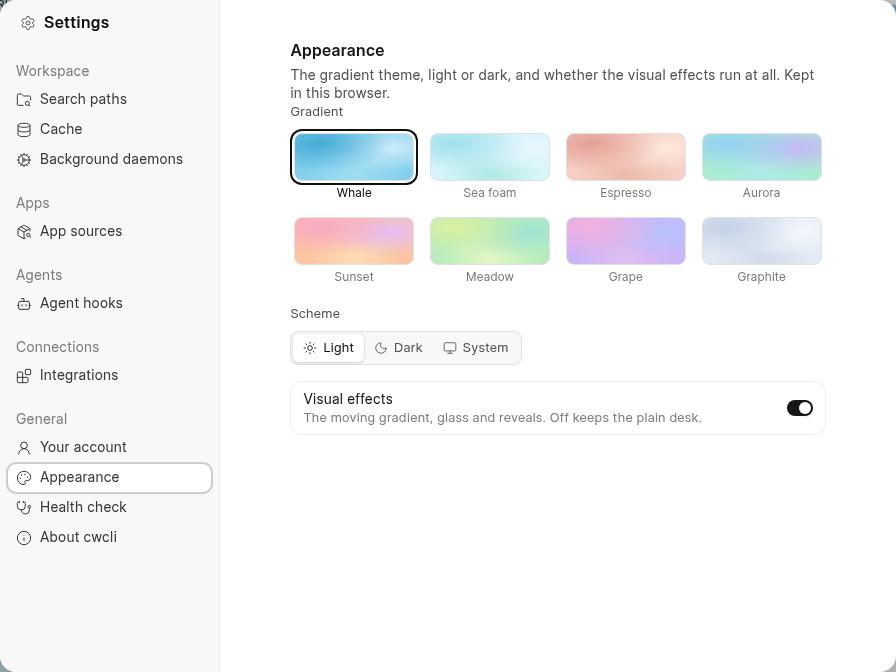 | 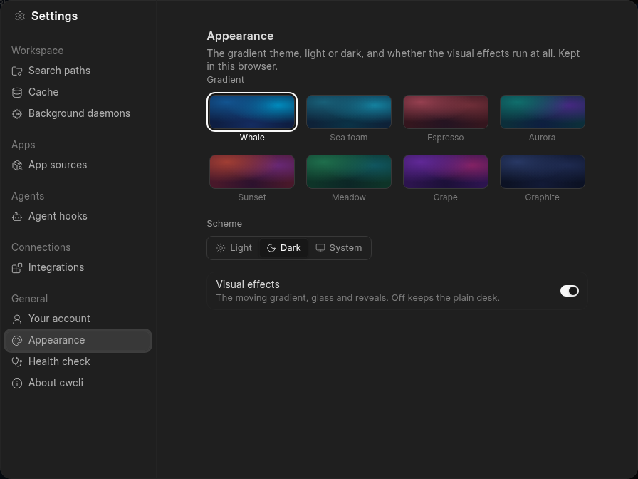 |

## The desk with effects on: Instances hero, gradient sidebar, detail header

Illustrative captures with names and source icons replaced: these were taken against real instances, and two things were replaced in the browser before each capture, with no code change.
Every instance, bench, path, host and user name in the page text was swapped for a neutral demo name (a text substitution over the rendered page).
Every App sources icon in the sidebar (GitHub, the self-hosted Git host and Marketplace) was swapped for the generic globe the page shows when a host has no icon, so no forge's own favicon appears.
The data shown is the layout, not any one machine.

The Instances page carries a hero on the gradient with a time-of-day greeting for the signed-in user, the running count and the bench, site and job totals, above the stock instance cards and the performance charts (the host chart now shows memory used).
With effects on, the sidebar's own surface is the gradient under a light tint and a matte grain; its fixed bottom block is set off from the nav by a soft fade-in hairline.

| Width | Light | Dark |
| --- | --- | --- |
| 1280 | 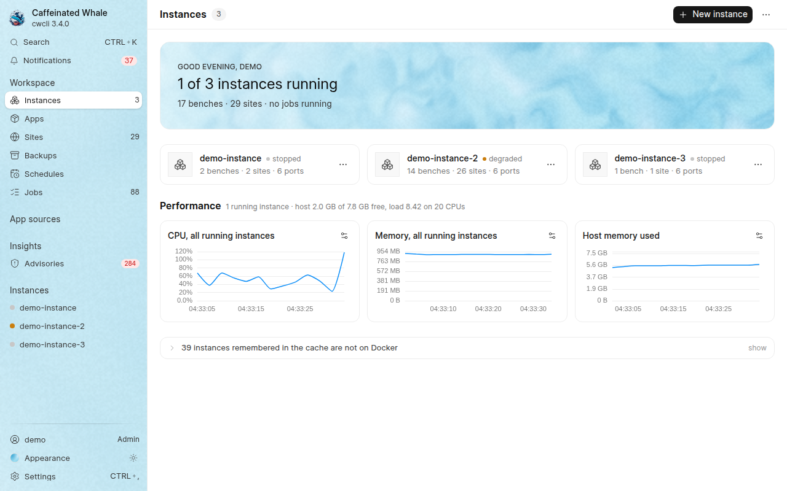 | 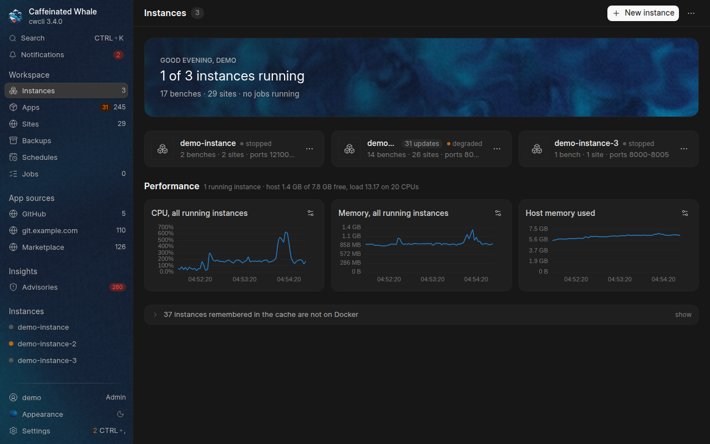 |
| 390 | 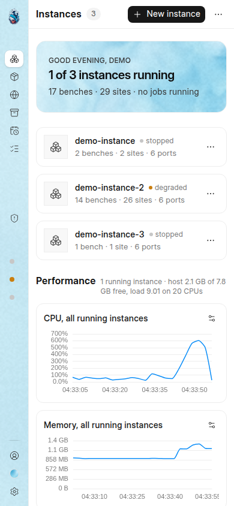 | 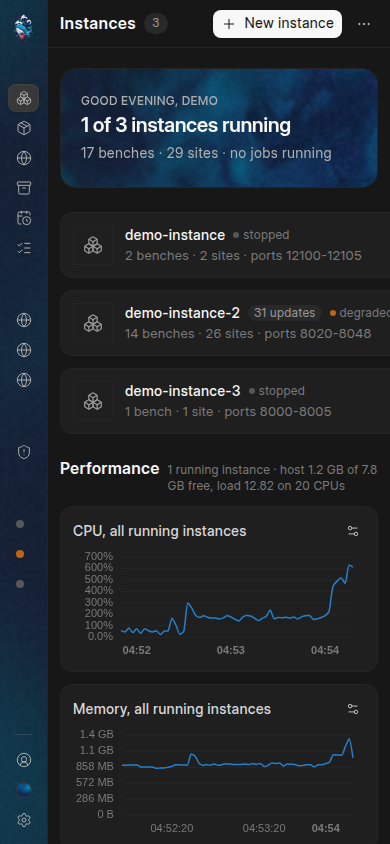 |

The instance, bench and site pages share one header card, which carries the same gradient and scrim and spans the content column like the hero.

| Light | Dark |
| --- | --- |
| 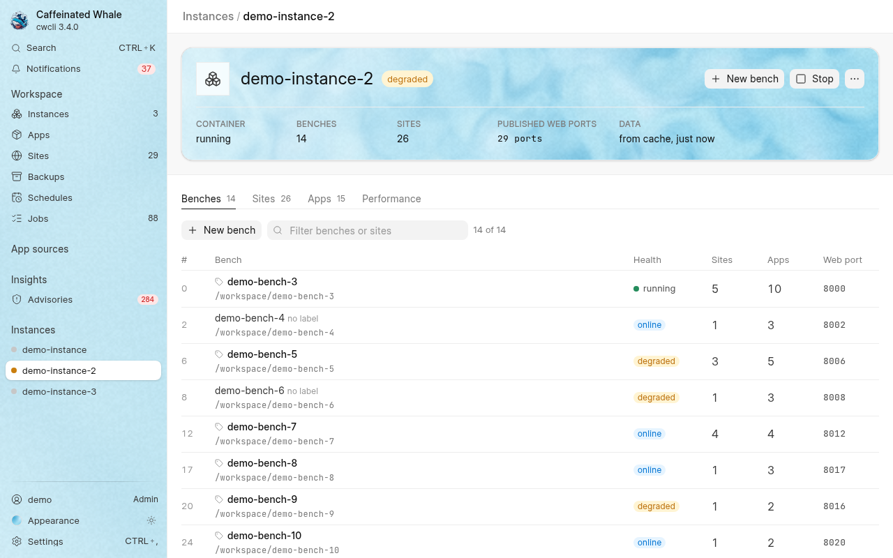 | 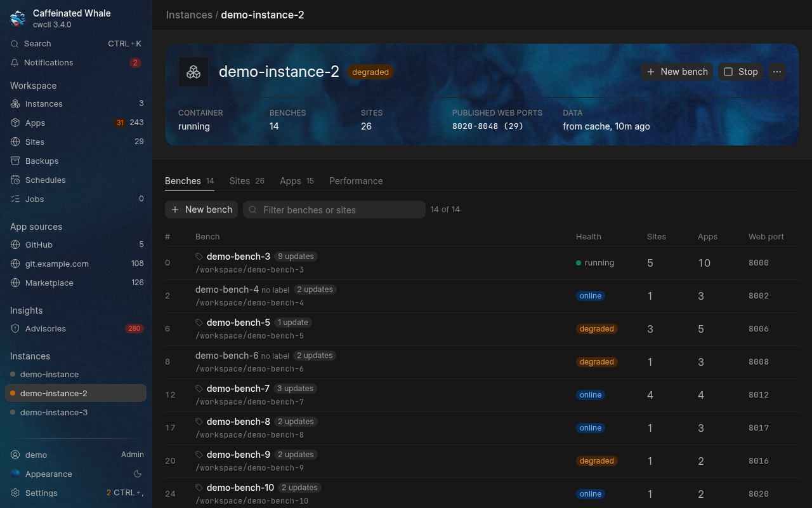 |

## The gradient

One fullscreen-quad WebGL fragment shader (domain-warped simplex noise, two octaves, four theme stops, static grain) draws every gradient surface: the sign-in's right half, the Instances hero, the detail header cards and the sidebar.
It renders at 0.4 of the CSS pixel size (the field is smooth; the browser upscales it), caps itself at 30 frames per second, and:

- stops drawing and holds one static frame when the visual-effects switch is off or `prefers-reduced-motion` is set;
- pauses while the tab is hidden or the canvas is scrolled out of view, and resumes from where it was;
- recovers a lost WebGL context, and falls back to a CSS radial gradient built from the same stops when there is no WebGL at all or the shader fails to compile or link;
- fires an occasional spot of turbulence (a swirl and a fading ripple at a random point, easing in and settling back over 1.8 s) every 9 to 17 seconds per surface, scheduled only inside the running frame loop, so never under reduced motion, with effects off, or while hidden.

Measured on a software rasteriser (headless Chrome with no GPU), a gradient covering the whole 1280 x 800 viewport costs about 180 percent of one CPU core; the sign-in half, the sidebar and the hero surfaces each cover a fraction of that area and cost proportionally less.
On a GPU it shades about 164 000 pixels with ten simplex evaluations each, 30 times a second, which is a small fraction of one percent of an integrated laptop GPU.

## Contrast over the gradient

Worst theme stop per surface, WCAG ratio (AA is 4.5:1 for body text, 3:1 for large text), computed from frappe-ui's ink tokens:

| Surface | Light, item labels / counts | Dark, item labels / counts |
| --- | --- | --- |
| Sidebar (stock surface at 45 percent over the gradient; dark body at 62 percent) | 10.6 / 6.9 | 7.2 / 4.6 |
| Hero and detail cards (scrim, text side) | 13.6 / 8.3 | 10.1 / 4.9 |

The sidebar's two faintest ink tokens (`ink-gray-5` and `ink-gray-6`, used for counts and section labels) step up to `ink-gray-7` with effects on, which is what keeps the counts above 4.5:1; the tint is the least that achieves that.

## Bundle

`npm run build` on this change: the main chunk is 819 kB raw / 248 kB gzip (up about 12 kB / 5 kB for the shared layer and the shader), and the Instances chunk carries motion-v for the hero's reveal (149 kB raw / 50 kB gzip, loaded on that route only).
The design-adherence lint stays green: every colour is a semantic token or a theme stop rendered from its RGB triple, and every menu icon is a `lucide-` name.
