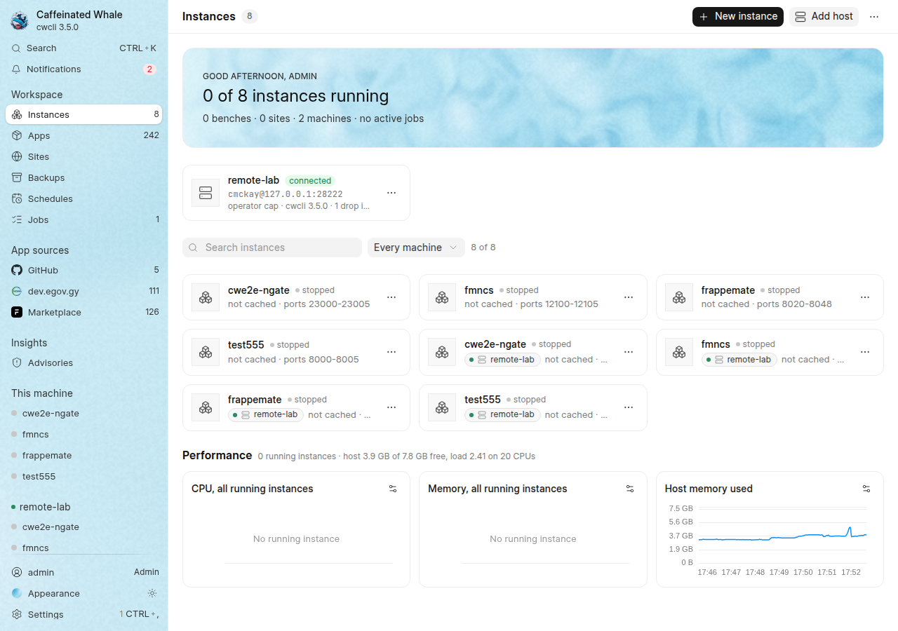
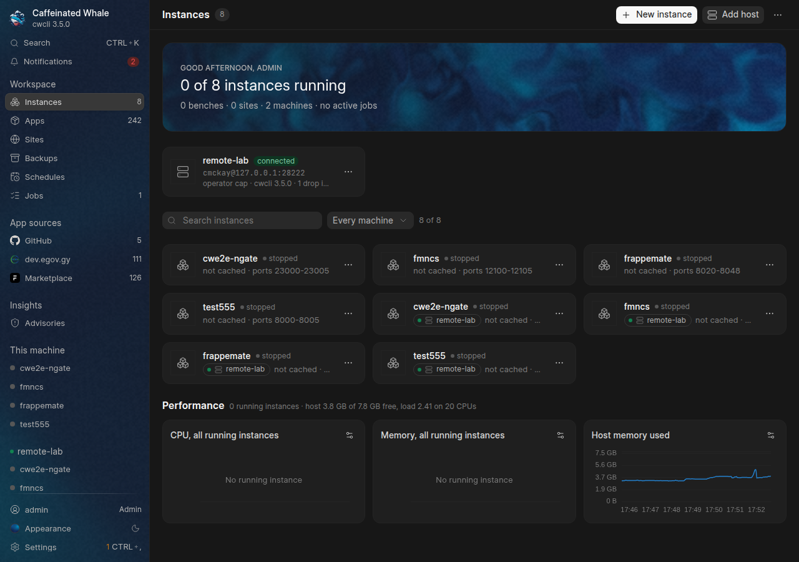
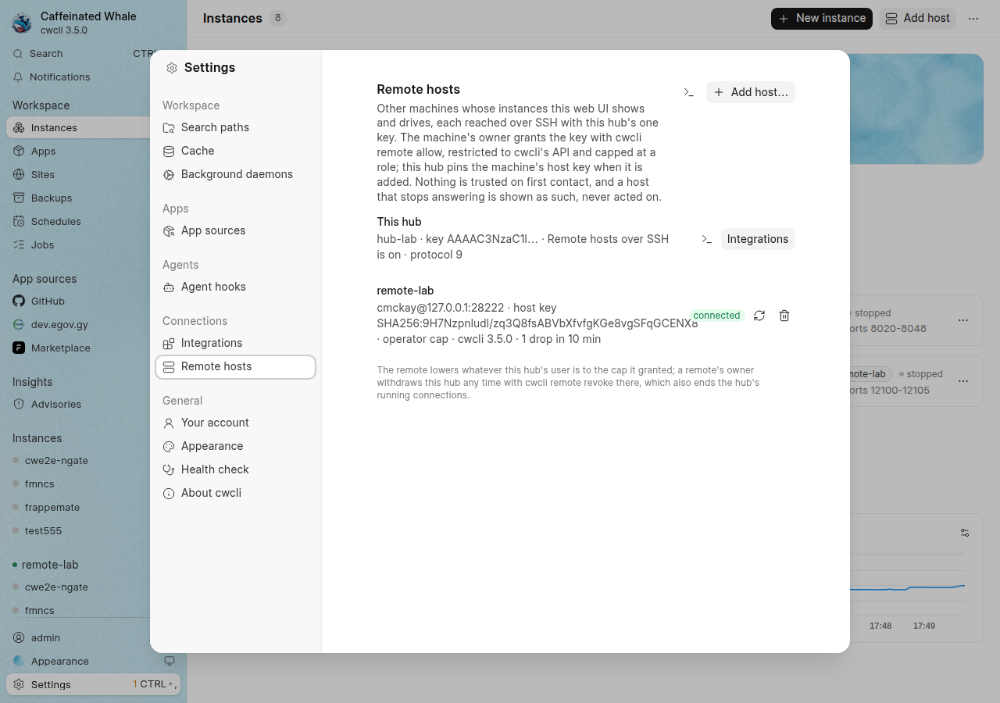
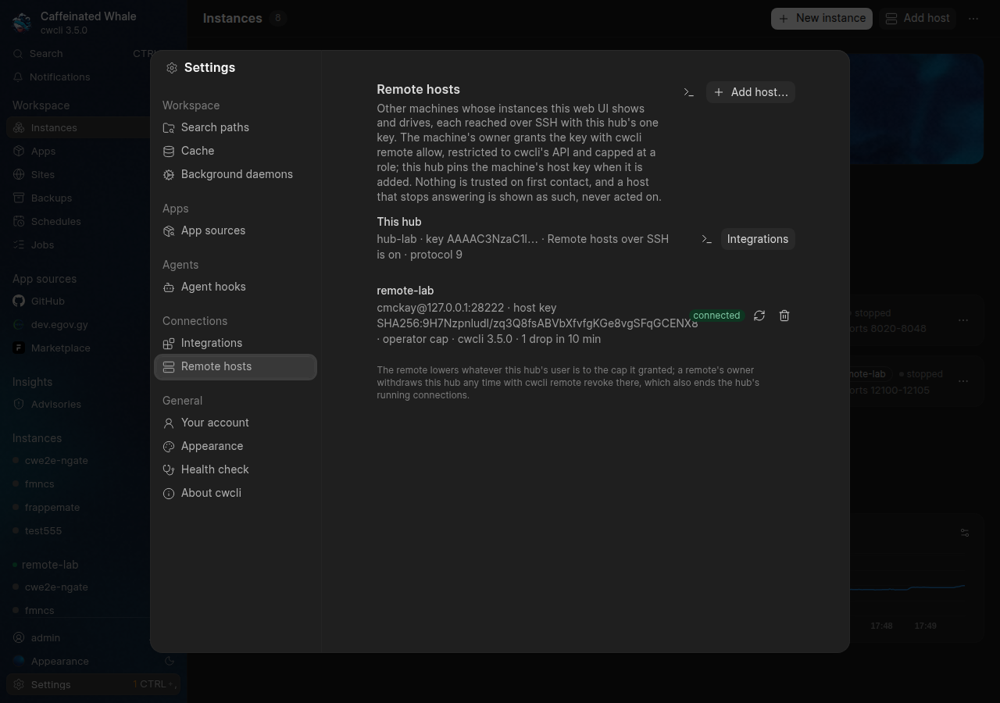
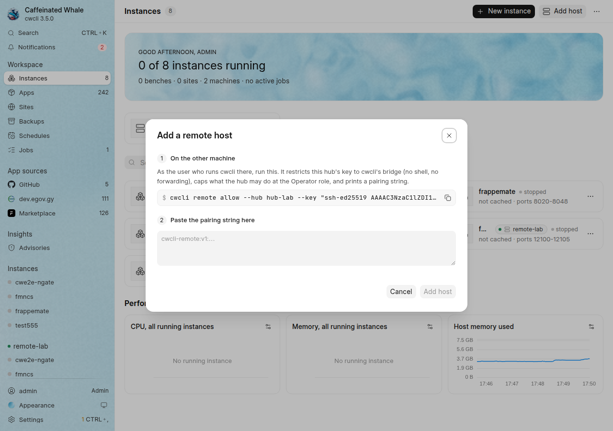
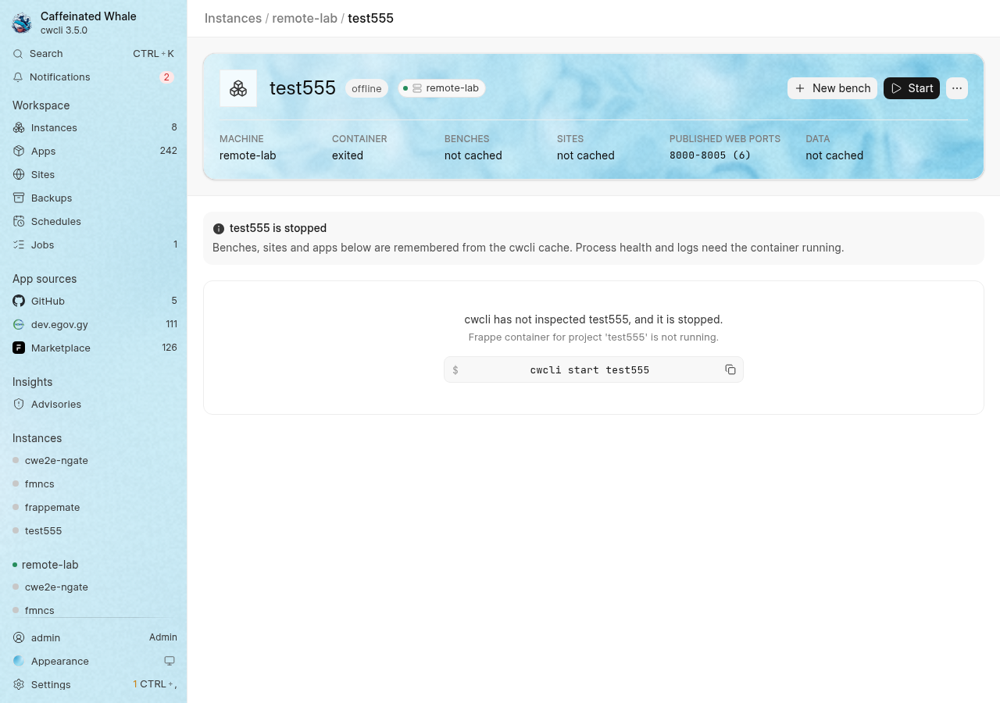
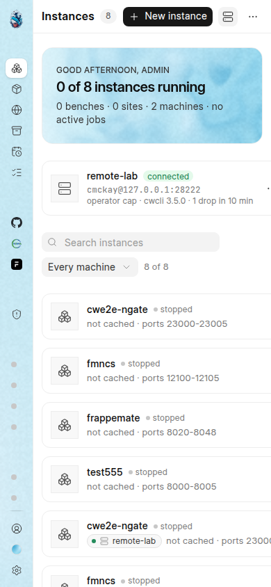
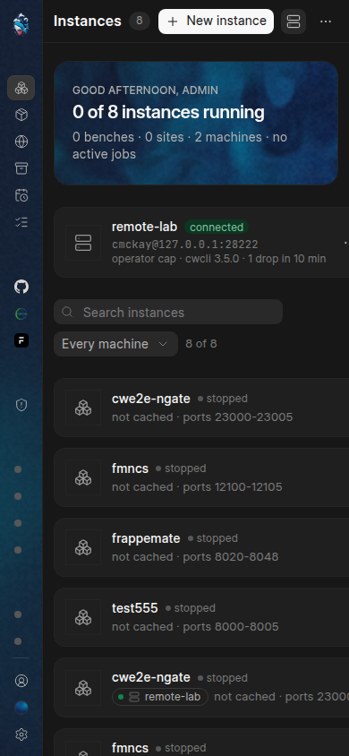

# Web UI remote hosts: two real cwcli daemons over real SSH

Evidence for the remote-hosts slice (captain-approved direction A, 2026-10-29): one machine's web UI (the hub) shows and drives the instances of another machine (the remote), each labelled by host, over SSH.
Both daemons under test were the shipped `cwcli ui` from this branch's editable install, each under its own isolated `CWCLI_HOME` under `/var/tmp`: the remote on `127.0.0.1:28765`, the hub on `127.0.0.1:28766`.
The SSH server was a private `sshd` on `127.0.0.1:28222` with its own host key and its own `authorized_keys` file, run as the same user, so nothing touched the machine's real SSH configuration.
The browser was driven with `chrome-devtools-axi` in a dedicated session, one screenshot at a time.
Every outcome below was read back from the daemons' API, the `authorized_keys` file, the hub's key directory or the remote's job record, never from the page's own words.
The same sequence is the committed real-SSH E2E, `tests/e2e/test_remote_hosts_e2e.py` (`standalone`, no Frappe instance needed).

## What was verified

- **Enrolment is a double opt-in with nothing trusted on first use.** Turning on the `Remote hosts over SSH` integration ran its test, which created the hub's Ed25519 key pair (`keys/hub_ed25519`, mode 0600) and named the hub `hub-lab`.
  On the remote, `cwcli remote allow --hub hub-lab --key "<hub key>" --max-role operator` wrote exactly one line into `authorized_keys`: `restrict,command="<venv python> -m caffeinated_whale_cli.bridge --hub hub-lab --max-role operator --home ... --state ... --keys ..." ssh-ed25519 <hub key> cwcli-hub:hub-lab`, and printed a pairing string carrying the remote's SSH host key.
  Adding that string on the hub (`POST /api/v1/hosts {op: add}`) pinned the key under a per-host alias in the hub's own `known_hosts` (0600) and answered `connected`, `cap: operator`, remote `protocol: 9` equal to the hub's (9 when this was taken; the rebase onto site publishing made it 10).
  A pairing string without a host key is refused (`host.key_required`); the unit tests pin that and the `StrictHostKeyChecking=yes` argv.
- **The key reaches cwcli's typed API and nothing else.** With the hub's private key, `ssh -p 28222 -- user@127.0.0.1 'cat /etc/hostname; id'` ran the bridge instead, which printed `bridge: this key is restricted to the cwcli bridge; it runs no command` and exited 2; stdin that is not an HTTP request got `bridge: expected an HTTP request`, exit 2; `ssh -N -L 29999:127.0.0.1:28765` was refused by `sshd` itself (`channel 2: open failed: administratively prohibited`) and the forwarded port answered nothing.
- **The remote caps what the hub may do.** Through the hub, whose bearer token is an Admin there, `POST /api/v1/hosts/remote-lab/settings` and `GET /api/v1/hosts/remote-lab/integrations` both came back `403 auth.role_forbidden` with `role: operator` from the remote.
  A request sent straight through the bridge carrying the remote's REAL daemon token in `Authorization` plus `X-Cwcli-Delegated-Role: admin` still got `403 ... role: operator`: the bridge drops every incoming credential and identity header, lowers the claim to its own `--max-role`, and adds the remote's token itself.
  The remote's own settings were untouched afterwards.
- **A job started through the hub runs on the remote and records the hub.** `POST /api/v1/hosts/remote-lab/jobs` with a `start` of a non-existent instance was admitted (202) and ran on the remote; its record there reads `origin: {via: hub, hub: hub-lab, account: api@hub-lab, account_source: hub, agent: cwcli-hub/3.5.0}` and ended `failed` with the remote's own reason; the hub read it back through the forward as a remote job.
- **Data, never code.** Every forwarded answer carried `X-Content-Type-Options: nosniff`, `Content-Security-Policy: default-src 'none'; sandbox` and `X-Cwcli-Host` (a header review removed later, since nothing read it), with no `Set-Cookie`; the remote's `session`, `stream` and `hosts` routes answered 404 through the hub.
  The hub's own stream carried the remote in its first `snapshot` frame (`hosts: [{id: remote-lab, state: connected, instances: [...]}]`).
- **Revocation reaches the connection that is already open.** `cwcli remote revoke --hub hub-lab` on the remote removed the line and ended the one running bridge process (the hub's held stream); with the hub's multiplexed SSH connection still open, the next forwarded read got the bridge's `403 bridge.revoked`, `check` answered `auth_refused: this host no longer accepts this hub`, and after `allow` again the link was `connected`.
- **A changed host key is a hard stop.** Re-pinning a different key on the hub (the Admin's explicit act, which also drops the old multiplexed connection) and checking answered `host_key_changed`; the link never reconnects by itself, and re-pinning the real key brought it back (unit-pinned and in the E2E).
- **Presence is reported, never acted on.** Stopping the remote daemon turned the link `daemon_down` with its `last_seen` kept; the hub's snapshot still carried the remote's instances, every one `unknown`, and an action on it was refused `409 host.not_connected`; nothing was started or retried, and restarting the daemon brought the link back (E2E).
- **The files.** `hosts.json`, `keys/hub_ed25519` and `keys/known_hosts` on the hub are all 0600; no API answer contains the private key or any token (`GET /api/v1/hosts` carries the public key line only).

## Screenshots

1280 px wide, light and dark:

390 px wide, light and dark:

